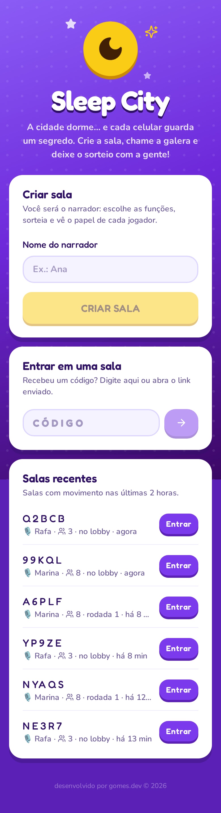
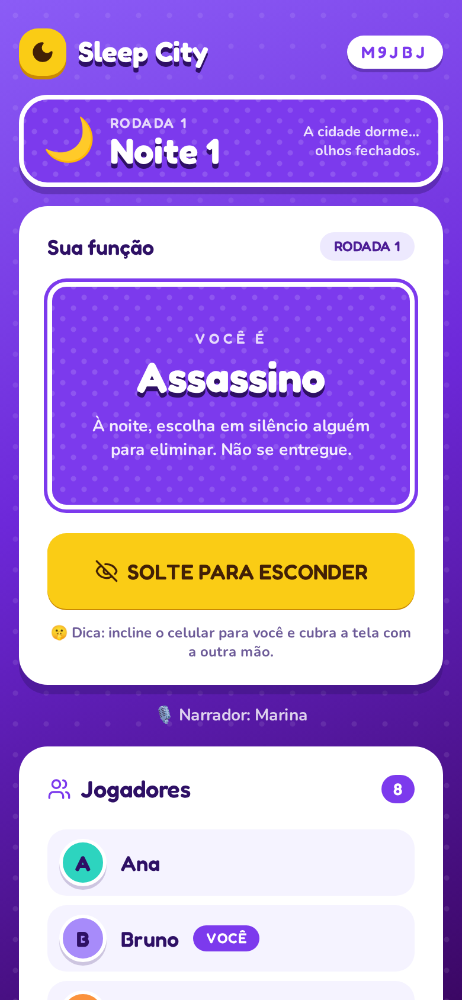
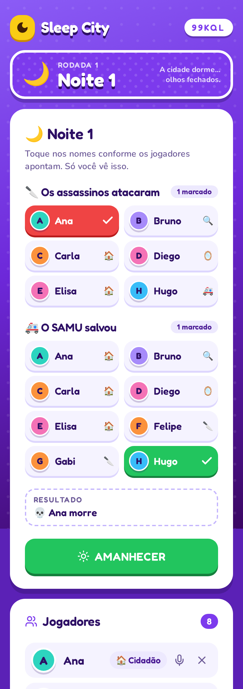
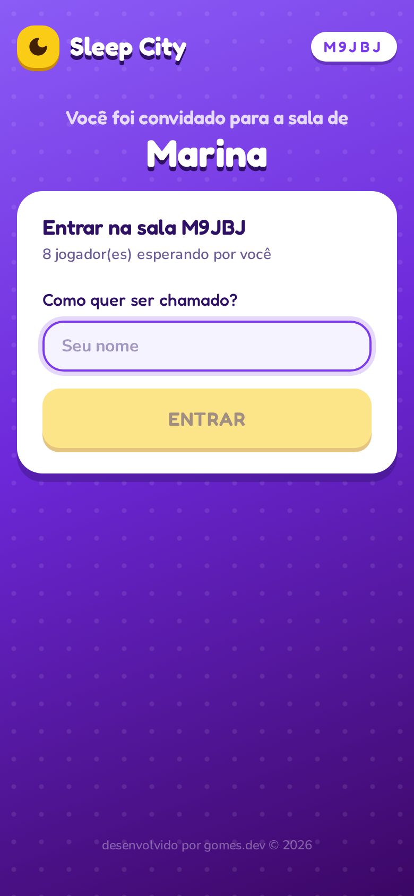
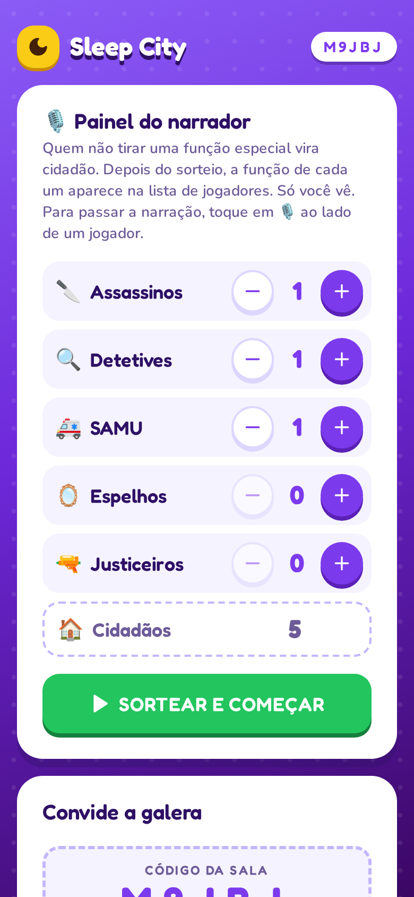
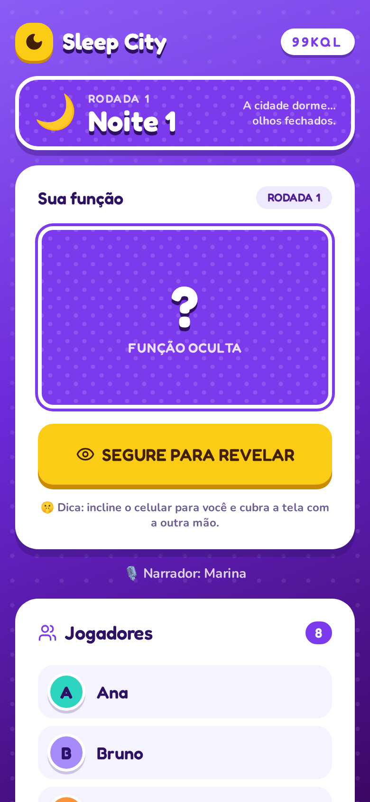
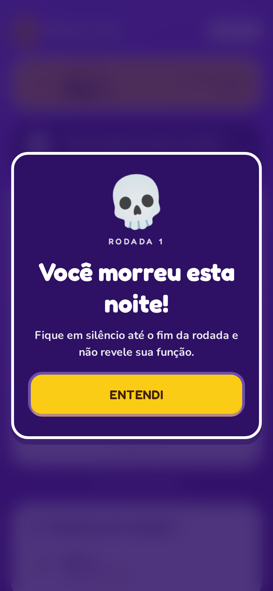
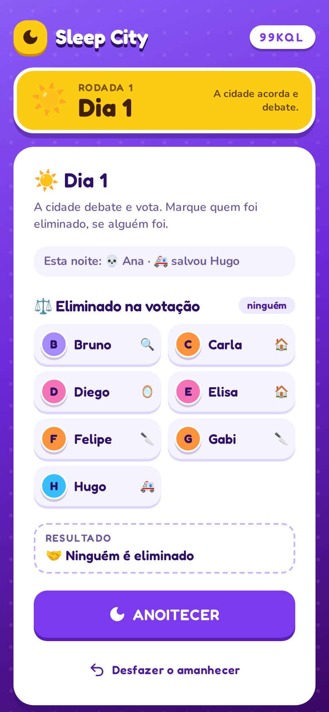
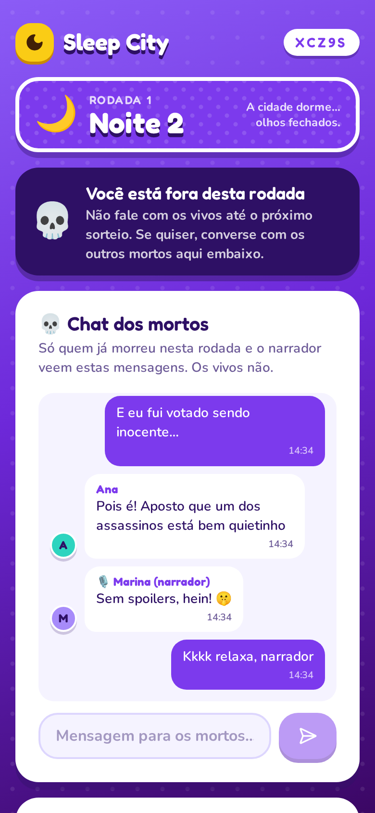
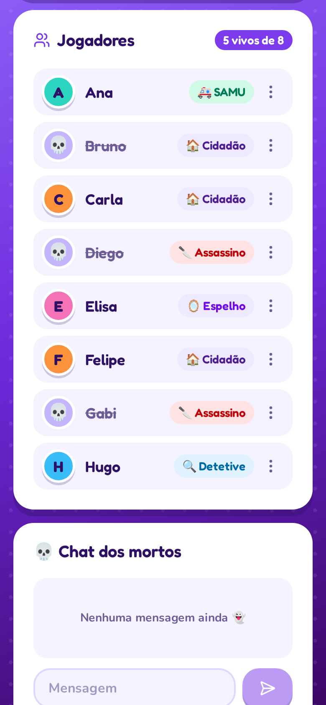

<div align="center">

# 🌙 Sleep City

**O ajudante de bolso para o Cidade Dorme.**
Crie a sala, chame a galera e deixe o sorteio, os segredos e a narração com o app.






</div>

---

## O que é

No **Cidade Dorme** (também conhecido como Máfia), os assassinos agem à noite e a cidade precisa descobrir quem são durante o dia. O problema de sempre: papelzinho, alguém que esquece a função, o narrador que se perde em quem morreu…

O **Sleep City** resolve isso com um link. Cada pessoa joga **no próprio celular**, vê **só a própria função**, e o narrador conduz as noites e os dias com tudo calculado na hora. Não tem cadastro nem instalação.

## Destaques

- 📱 **Um link, todo mundo dentro.** Compartilhe por link, pelo menu do celular ou por QR code.
- 🤫 **Segredo de verdade.** O servidor só manda para cada jogador a função dele. A função fica escondida até a pessoa **segurar o botão**.
- 🎲 **Sorteio justo.** Feito no servidor, com memória: quem tirou a mesma função 2 vezes seguidas tem **10× menos chance** de tirar pela 3ª.
- 🎙️ **Painel do narrador.** Toque em quem foi atacado, salvo ou votado e o app mostra quem morre antes de confirmar.
- 🌗 **Noites e dias para todos.** Todo celular mostra a fase atual e um aviso em tela cheia a cada amanhecer e anoitecer.
- 💀 **Chat dos mortos.** Quem morre não precisa ficar só olhando: dá para conversar com os outros mortos, sem que os vivos vejam.
- 🪞🔫 **Funções extras.** Espelho e Justiceiro deixam as partidas mais imprevisíveis.
- 🏆 **Fim de jogo automático.** O narrador vê na hora quando a cidade ou os assassinos vencem.
- 🧹 **Sem bagunça.** As salas recentes aparecem na tela inicial, e as que ficam paradas por 2 horas são limpas sozinhas.

## Como jogar

### 1. Crie a sala e convide

Quem cria a sala é o **narrador**: não entra no sorteio e vê a função de todos. Os amigos abrem o link, digitam o nome e pronto.

<p align="center">
  
  
  
</p>

### 2. Sorteie e descubra sua função

O narrador escolhe quantas funções de cada tipo e toca em **Sortear**. Quem não recebe uma função especial vira cidadão. A função fica escondida e só aparece enquanto o botão está pressionado. Todas as funções têm o mesmo visual, então quem está do lado não consegue adivinhar pela cor.

<p align="center">
  
  
</p>

### 3. Conduza as noites e os dias

À noite, o narrador marca quem os assassinos atacaram, quem o SAMU salvou e, quando for a vez dele, em quem o Justiceiro atirou. O resultado aparece antes de confirmar. De dia, marca quem a cidade eliminou na votação. Quem morre recebe um aviso no próprio celular.

<p align="center">
  
  
  
</p>

### 4. Converse com os outros mortos

Quem morre ganha acesso ao **chat dos mortos** da rodada. Os mortos podem comentar o jogo à vontade, e o narrador lê e pode responder. Os vivos não veem nem recebem nada desse chat. A cada nova rodada, o chat começa vazio.

<p align="center">
  
</p>

### 5. Veja quem venceu

Assim que um lado vence, o painel do narrador avisa. Depois é só tocar em **Sortear nova rodada**, com os mesmos jogadores.

<p align="center">
  
</p>

## Funções

| | Função | O que faz |
|:-:|---|---|
| 🔪 | **Assassino** | À noite, escolhe em silêncio alguém para eliminar. Cada assassino ataca uma pessoa. |
| 🔍 | **Detetive** | À noite, aponta um suspeito ao narrador e descobre se ele é assassino. |
| 🚑 | **SAMU** | À noite, escolhe alguém para salvar caso essa pessoa seja atacada. |
| 🪞 | **Espelho** | Se for atacado, o golpe volta para um dos assassinos. Funciona **uma vez** por rodada. |
| 🔫 | **Justiceiro** | Em noites sorteadas (1 chance em 3), atira em alguém. Se acertar um inocente, morre de culpa. |
| 🏠 | **Cidadão** | Sem poder especial: observa, debate e vota. |

### Regras da noite

A noite é resolvida nesta ordem:

1. **Ataques.** Quem foi atacado morre. Se o atacado for um Espelho ainda não usado, o ataque volta para um assassino sorteado.
2. **Tiro do Justiceiro.** O alvo morre.
3. **SAMU.** Quem o SAMU salvou escapa de qualquer uma dessas mortes, inclusive o assassino atingido pelo Espelho.
4. **Culpa.** Se o Justiceiro matou um inocente, ele morre também. Se o SAMU salvou o alvo, não há culpa.

### Quem vence

- 🏆 **A cidade** vence quando não sobra nenhum assassino.
- 🔪 **Os assassinos** vencem quando são maioria. Também vencem quando estão **empatados** com o resto e a próxima noite com certeza mata alguém, ou seja, há menos SAMU vivos do que assassinos e não sobrou Justiceiro nem Espelho ainda não usado.

## Para o narrador

- **Desfazer.** Tocou errado? Volte um passo.
- **Histórico da rodada.** Veja noite a noite quem foi atacado, salvo e votado.
- **Passar a narração.** Toque em 🎙️ ao lado de um jogador. Ele vira o narrador e você entra no jogo. Como o narrador conhece todas as funções, a rodada atual é encerrada.
- **Trocou de celular?** Se um jogador entrar de novo com o **mesmo nome**, a nova sessão assume o lugar dele, com a mesma função e vivo ou morto, e a antiga sai da sala.

## Privacidade

- Não há cadastro. Cada navegador recebe uma sessão aleatória salva no próprio aparelho.
- O servidor nunca envia a função de outra pessoa para um jogador. O que aconteceu à noite (ataques, SAMU, Espelho, Justiceiro) só o narrador vê. Os jogadores veem apenas quem morreu.
- A função também se esconde ao trocar de aba, bloquear a tela ou começar uma nova rodada.
- O chat dos mortos só é enviado para quem já morreu na rodada e para o narrador. O servidor recusa mensagens de quem está vivo.
- O tema é escuro e de pouco brilho, para não chamar atenção em uma sala com pouca luz.

---

## Para desenvolvedores

### Tecnologia

| Camada | Stack |
|---|---|
| Frontend | React 19, Vite, Tailwind CSS v4, [shadcn/ui](https://ui.shadcn.com) |
| Backend | Node.js + Express 5, publicado como Vercel Function (`api/index.ts`) |
| Estado | Upstash Redis (Marketplace da Vercel); em memória quando roda localmente |
| Regras | `shared/night.ts`, usado pelo servidor (para valer) e pela tela do narrador (prévia) |

Os clientes consultam o estado a cada 2,5 s, o que dá folga de sobra no plano gratuito do Upstash para uma noite de jogo.

### Rodando localmente

```bash
npm install
npm run dev
```

- Web: http://localhost:5173. As chamadas a `/api` são redirecionadas para `localhost:3001`; use `API_PORT` para trocar a porta.
- Para simular vários jogadores no mesmo computador, use navegadores diferentes ou janelas anônimas. Cada uma vira uma sessão.
- Para testar no celular na mesma rede Wi-Fi, abra o endereço `Network` que o Vite mostra.
- Sem variáveis de ambiente, as salas ficam em memória e somem quando o servidor reinicia. Para usar Redis, copie `.env.example` para `.env` e preencha.

### Deploy na Vercel

1. Importe o repositório na Vercel (**Add New → Project**). O `vercel.json` já configura o Vite e o `/api`; é só clicar em **Deploy**.
2. Em **Storage → Create Database → Upstash (Redis)**, crie o banco no plano gratuito e conecte ao projeto. As variáveis `KV_REST_API_URL` e `KV_REST_API_TOKEN` (ou `UPSTASH_REDIS_REST_*`) entram sozinhas.
3. Faça um **Redeploy** para que as variáveis passem a valer.

> ⚠️ O Redis é obrigatório em produção: as funções serverless da Vercel não compartilham memória, então sem ele as salas "somem".

### Ciclo de vida das salas

- O chat dos mortos fica em `sc:room:CODIGO:chat:RODADA` (as 200 últimas mensagens de cada rodada) e expira junto com a sala.

- Uma sala **sem nenhuma ação por mais de 2 horas** (sorteio, noite, dia, desfazer, troca de narrador ou jogador entrando, saindo ou sendo removido) é apagada com **soft delete**. Só ficar com o app aberto não conta como ação.
- Uma sala apagada ganha `deletedAt`, sai da lista de salas recentes e o link passa a mostrar "sala não encontrada". Os dados continuam no Redis até expirarem, 12 horas depois.
- A limpeza (`cleanupIdleRooms` em `server/app.ts`) roda quando a tela inicial pede a lista de salas e quando alguém tenta abrir uma sala parada.

### API

Todas as rotas usam o header `x-client-id`, que identifica a sessão do navegador.

| Método | Rota | Quem | Descrição |
|---|---|---|---|
| GET | `/api/rooms` | qualquer um | salas com movimento nas últimas 2 horas |
| POST | `/api/rooms` | qualquer um | cria uma sala (`{ name }`) |
| GET | `/api/rooms/:code` | qualquer um | estado da sala e as funções que você pode ver |
| POST | `/api/rooms/:code/join` | qualquer um | entra na sala (`{ name }`) |
| POST | `/api/rooms/:code/leave` | jogador | sai da sala |
| POST | `/api/rooms/:code/start` | narrador | sorteia as funções (`{ counts }`) |
| POST | `/api/rooms/:code/dawn` | narrador | fecha a noite (`{ attacked, saved }` = pids, `shots` = `[{ by, target }]`) |
| POST | `/api/rooms/:code/dusk` | narrador | fecha o dia (`{ voted }` = pids) |
| POST | `/api/rooms/:code/chat` | morto ou narrador | manda uma mensagem no chat dos mortos (`{ text }`, até 300 caracteres) |
| POST | `/api/rooms/:code/undo` | narrador | desfaz o último amanhecer ou anoitecer |
| POST | `/api/rooms/:code/reset` | narrador | encerra a rodada e volta ao lobby |
| POST | `/api/rooms/:code/kick` | narrador | remove um jogador (`{ pid }`) |
| POST | `/api/rooms/:code/transfer` | narrador | passa a narração a um jogador (`{ pid }`) |

### Logs

O servidor escreve uma linha por evento, sempre começando com `[sala CODIGO]`: sala criada ou apagada, entradas e saídas, cada sorteio com a função de todos, sequências de função repetida, noites, votações, vitórias, desfazer e troca de narrador. Erros de regra (ex.: `409 A rodada já mudou`) também aparecem.

Na Vercel, abra o projeto, vá em **Logs** e busque pelo código da sala. No plano gratuito os logs ficam disponíveis por cerca de 1 hora. Localmente, eles aparecem no terminal do `npm run dev`.

### Estrutura

```
api/index.ts          # entrada da Vercel Function (exporta o app Express)
server/app.ts         # rotas da API, logs e limpeza das salas
server/game.ts        # sorteio, validações, códigos de sala
server/store.ts       # Redis (Upstash) ou memória
server/dev.ts         # servidor local da API
shared/night.ts       # regras da noite e da vitória (servidor + tela do narrador)
src/pages/            # Home e Sala
src/components/       # RoleReveal, HostPanel, TurnPanel, TurnHistory, DeadChat, RecentRooms, PhaseBar, Announcement…
src/components/ui/    # componentes shadcn/ui
docs/screenshots/     # imagens deste README
```

---

<div align="center">
<sub>desenvolvido por <b>gomes.dev</b> © 2026</sub>
</div>
